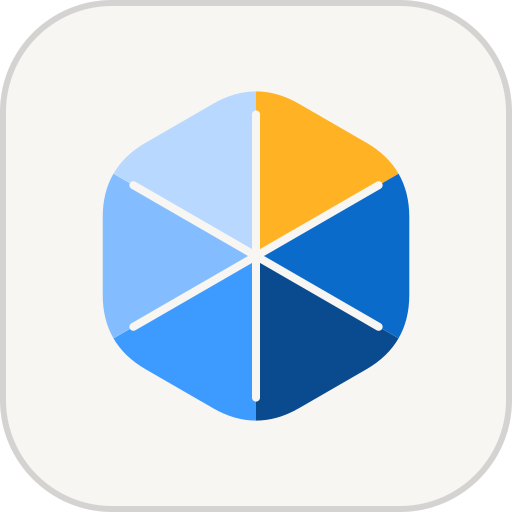
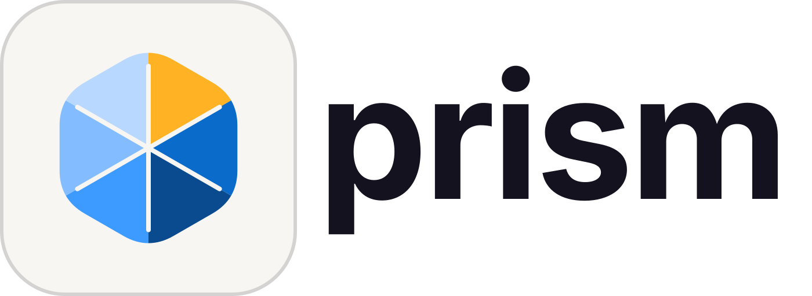

# prism brand

## Idea

One skill goes in. It is checked from several angles, and each angle shows what the others miss. The mark is a faceted gem: one solid body cut into six facets, each a different view. The amber facet is the finding.

Tagline: **Every skill, seen from every side.**
Badge line: **One skill in. Six lenses out.**

## Personality

A calm, exacting inspector. Four traits:

- **Precise.** Every claim has a quote and a line number.
- **Candid.** Says "this will break" plainly. Never hedges a real bug.
- **Kind.** Critiques the skill, never the author. "No significant issues" is a good result.
- **Unfussy.** Short sentences. No hype, no filler, no scolding.

## Voice

| Do | Don't |
|---|---|
| Quote the line: `Step 3 says "then retry"` with no retry limit. | "Oops, something seems a little off here." |
| State the result: "This will break on empty input." | "Maybe consider possibly handling empty input?" |
| Praise a clean result plainly: "No significant issues." | "Amazing skill!!" |
| Name the fix, then stop. | Lecture the author about best practices. |

Sample lines:

- Clean result: "No significant issues. Facet approves."
- Bug: "Step 2 reads `config.yaml`, but no step creates it. The first run will fail. Add a check or a default."
- Taste (not a bug): "The examples repeat the intro. Optional to trim."

## Palette

Blue carries the mark. Amber is the one accent, reserved for the finding. Facets run clockwise from the top-right: amber, blue 4, blue 5, blue 3, blue 2, blue 1. Light comes from the top-left, so blue 1 is the lightest.

| Name | Hex | Use | vs Paper | vs Ink |
|---|---|---|---|---|
| Paper | `#F7F6F2` | Mark tile, light surfaces | n/a | 17.09:1 |
| Ink | `#14121F` | Text, outlines, dark tile | 17.09:1 | n/a |
| Amber | `#FFB224` | Accent facet inside the logo (decorative) | 1.67:1 | 10.25:1 |
| Amber Deep | `#D07A00` | Amber marks on light backgrounds (non-text, 3:1) | 3.00:1 | 5.69:1 |
| Amber Deep Text | `#A56100` | Amber text on light backgrounds (4.5:1) | 4.51:1 | 3.79:1 |
| Blue 1 (lightest) | `#B8D8FF` | Top-left facet | 1.36:1 | 12.59:1 |
| Blue 2 | `#84BDFF` | Left facet | 1.81:1 | 9.42:1 |
| Blue 3 | `#3D9BFF` | Bottom-left facet | 2.65:1 | 6.45:1 |
| Blue 4 | `#0B6BCB` | Right facet | 4.88:1 | 3.50:1 |
| Blue 5 (darkest) | `#0A4A8F` | Bottom-right facet | 8.13:1 | 2.10:1 |

Rules for the accent:

- The logo and mascot keep the bright amber `#FFB224`. Logos are decorative, not text.
- On light backgrounds, amber marks and text use Amber Deep (`#D07A00`) for graphics and Amber Deep Text (`#A56100`) for text. Do not put `#FFB224` text on Paper; it reaches 1.67:1.
- Keep amber to one element per view. It marks the finding, so it should be rare.

Accent contrast within the gem: amber against each blue is 1.09:1 to 4.87:1. The gaps between facets, not the hue alone, separate the shapes.

## Color choice

Four palettes were rendered and measured (blue + amber, violet + amber, indigo + coral, teal + magenta). Blue + amber was chosen for these reasons:

- Blue is the most preferred color across cultures and genders (Palmer & Schloss, 2010, *PNAS* 107(19):8877-8882, doi:10.1073/pnas.0906172107).
- Blue is linked to competence, which fits a reviewer (Labrecque & Milne, 2012, *Journal of the Academy of Marketing Science* 40(5):711-727, doi:10.1007/s11747-010-0245-y).
- Blue against orange is the color-blind-safe axis (Okabe & Ito, *Color Universal Design*, https://jfly.uni-koeln.de/color/). Teal + magenta fails this test: its accent collapses into the tints under deuteranopia and protanopia.
- Pair preference rises with lightness contrast and falls with hue difference. Amber is kept as a small accent, not a second hue family (Schloss & Palmer, 2011, *Attention, Perception & Psychophysics* 73(2):551-571, doi:10.3758/s13414-010-0027-0).
- Measured worst-case separation of the accent from its nearest facet tint (CIE76 dE, larger is safer):

| Palette | Normal | Deuteranopia | Protanopia | Tritanopia |
|---|---|---|---|---|
| P1 Blue + Amber (chosen) | 99.9 | 98.0 | 97.3 | 61.2 |
| P2 Violet + Amber | 88.6 | 86.3 | 89.7 | 43.4 |
| P3 Indigo + Coral | 74.7 | 62.4 | 55.5 | 76.6 |
| P4 Teal + Magenta | 85.6 | 19.7 | 12.0 | 102.2 |

Figures for P1 are for the final tints. The other palettes used the earlier tints.

Accessibility thresholds used: WCAG 2.1 success criterion 1.4.3 (text, 4.5:1) and 1.4.11 (non-text graphics, 3:1). The lightest blue is below 3:1 on Paper by design. It is a fill, not a line or a text color.

## Logo

- **Mark** (`assets/logo.svg`): a Paper tile with a faint Ink border, holding a regular hexagonal gem with rounded corners (radius about 28% of the side). Six triangular facets meet at the center. Thin 8 px paper gaps run from the center to 80% of the way to each corner, so the corners stay solid color.
- **Wordmark** (`assets/wordmark.svg`): the mark plus lowercase "prism" in a geometric sans (Inter, Helvetica Neue, Arial fallback), weight 700, Ink.

  

- **Icon** (`.claude-plugin/icon.png`): the mark at 1024 x 1024.
- **Clear space**: keep a margin of at least 1/8 of the tile width on every side.
- **Minimum size**: 16 px for the mark. Below 24 px the facet gaps blur, so prefer 32 px and up when the mark sits in text.

Do not:

- Recolor the facets, reorder them, or add a color.
- Rotate the gem or flatten it into an outline.
- Add shadows, gradients, or glow.
- Place the mark on a busy photo or pattern. Use the Paper or Ink tile.

## Mascot: Facet

Facet is the gem with a face. It has the same softened silhouette and facets as the logo. It has two oval eyes below the middle, a small smile, and a jeweler's loupe over one eye. The loupe is the role cue: Facet is an inspector who looks closely.

Personality: calm, competent, curious. Reads every line twice and quotes what it finds. Happiest when it finds nothing wrong.

Use Facet:

- In the README "Meet Facet" section.
- In clean-result moments, such as "No significant issues. Facet approves."

Do not use Facet:

- On the plugin icon, the logo mark, or the wordmark.
- In error messages, security warnings, or reports of a critical bug.
- Anywhere it would mock the author of the audited skill.

## Why it looks like this

These are design heuristics from the literature, applied by judgment:

- Curved shapes are preferred to angular ones (Bar & Neta, 2006, *Psychological Science* 17(8):645-648). The 28% corner rounding follows this.
- Round shapes read as soft and caring, angular ones as durable (Jiang, Gorn, Galli & Chattopadhyay, 2016, *Journal of Consumer Research* 42(5):709-726, doi:10.1093/jcr/ucv049). The gaps stop short of the edge, so the rounded gem still reads as precise.
- Moderate, natural elaborateness is preferred over very simple or very busy designs (Henderson & Cote, 1998, *Journal of Marketing* 62(2):14-30). Six facets is the middle ground.
- Symmetry and contrast make a figure easier to process, which reads as trust (Reber, Schwarz & Winkielman, 2004, *Personality and Social Psychology Review* 8(4):364-382, doi:10.1207/s15327957pspr0804_3).
- A mascot's face should fit its role (Aggarwal & McGill, 2007, *Journal of Consumer Research* 34(4):468-479, doi:10.1086/518544). The loupe gives Facet its inspector role, and the face does nothing else.
- Large eyes and a round head read as friendly (Glocker et al., 2009, *Ethology* 115). Facet's eyes are large ovals, not cartoon-sized.

**Honest status:** no user testing has been run yet. Two tests to run before this design is final:

1. Out-of-context identification: show the mark at 16, 24, and 32 px with no name. Ask what it is. Keep the gem if most viewers say gem, prism, or a similar shape.
2. Fits-role check for Facet: show the mascot with and without the loupe. Ask viewers to rate it "fits role" to "forced" on a 1 to 7 scale.
